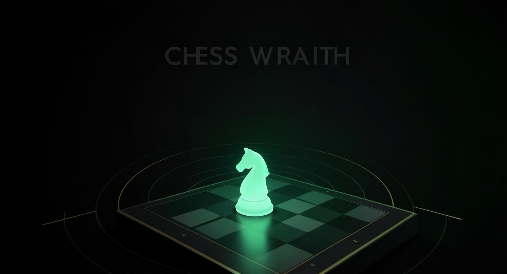

<div align="center">
  
</div>

<p align="center">
  
</p>

<h1 align="center">CHESS WRAITH</h1>

<p align="center">
  <strong>Chess.com, at your pace.</strong><br>
  A Tampermonkey userscript that runs Stockfish locally, shows what it sees,
  and optionally plays for you with human timing.
</p>

<p align="center">
  <a href="https://github.com/ezurinho/chess-wraith/releases/latest/download/chess-wraith.user.js"></a>
  <a href="https://github.com/ezurinho/chess-wraith/releases/latest"></a>
  <a href="https://github.com/ezurinho/chess-wraith/actions/workflows/check.yml"></a>
  <a href="LICENSE"></a>
  <a href="CHANGELOG.md"></a>
</p>

<p align="center">
  <a href="#install">Install</a> ·
  <a href="#controls">Controls</a> ·
  <a href="#what-it-does">What it does</a> ·
  <a href="#honest-limits">Honest limits</a> ·
  <a href="#development">Development</a> ·
  <a href="CHANGELOG.md">Changelog</a>
</p>

<p align="center">
  
</p>

<p align="center">
  
</p>

> One tab, one account, no passwords. The engine, the board reader and the
> panel all run locally; nothing is uploaded and there is no telemetry.

CHESS WRAITH reads the board chess.com already rendered, asks a local Stockfish
19 NNUE for its opinion, and — only if you turn auto-play on — plays a move with
a delay and an input path that a person could have produced.

## Install

1. Install [Tampermonkey](https://www.tampermonkey.net/) (or Violentmonkey).
2. Open **[chess-wraith.user.js](https://github.com/ezurinho/chess-wraith/releases/latest/download/chess-wraith.user.js)** and confirm the install.
3. Open any game, bot match or analysis board on `https://www.chess.com`.
4. The panel appears in the top-right corner. Auto-play is **off** until you press **Auto** (or `Alt+Shift+A`).

The first run downloads the engine from jsDelivr, once. After that your browser
cache serves it and the whole thing works offline.

## Controls

| Control | What it does |
| --- | --- |
| **Auto** / `Alt+Shift+A` | Turns auto-play on or off. The setting survives reloads. |
| **AFK** / `Alt+Shift+F` | Rematch, keep-alive and play-while-hidden in one switch. |
| Rail (left icons) | Live, Tune and Info views; drag the title to move the panel. |
| Swatches in Tune | Six themes: Carbon, Aurora, Sunset, Ice, Violet, RGB. |
| **Step** / `Alt+Shift+M` | Plays the current suggestion once, even with auto-play off. |
| **Scan** | Re-reads the board and re-runs the engine now. |
| **⚙** | Style, target Elo, depth, think time, delay window, slack, line count. |
| **–** / double-click the header | Collapses the panel to a header. |
| **Hide** / `Alt+Shift+H` | Hides the panel completely; the script keeps running. |
| Header drag | Moves the panel anywhere. |

## What it does

| Area | Behaviour |
| --- | --- |
| **Board reading** | Grid, orientation, move list (`data-ply` or `.node` rows), last-move highlights, clocks, opponent rating and the game-over modal, straight from the DOM. |
| **Turn detection** | The turn is taken from the move list, the running clock or the last-move highlight, and the source is recorded. When none of the three is readable the panel says `turn not readable; not playing` and nothing is played on a guess. |
| **Engine** | Stockfish in a blob worker. It tries Stockfish 19 NNUE (Lite, single thread, WASM, WDL + MultiPV) first and falls back to the bundled Stockfish 2019 JS build when the NNUE build cannot resolve its `.wasm` from a blob worker. The panel always shows which one is running. |
| **Analysis** | Evaluation from White's point of view, best move in SAN, candidate lines with depth, and the engine's own strength limiter (`UCI_Elo`) when a style asks for it. |
| **Styles** | `adaptive` (measures the opponent's centipawn loss, then sits ~130 Elo above them), `gm`, `club`, `casual` and `full engine`. The target Elo is applied to the engine itself through `Skill Level`, so a preset changes how well it plays, not only how randomly it picks. |
| **Deliberate misses** | Casual misses 12% of the time, Adaptive 5%, capped at 2.5× the style's slack. Never at the cost of a forced mate; Club and GM always play their best available line. |
| **Pacing** | Delays inside your own window, plus the gap between the top two lines (±18–28%), checks (+12%), captures (−8%), a 3.5% chance of a rare second thought, and faster play on a low clock. The window is then kept inside 0.65×–1.5× of this account's own learned rhythm, and never below 35% of the opponent's think time. |
| **Per account** | Settings are global; the opening memory and the learned pace are stored per signed-in username, so two accounts on one browser do not share a fingerprint. |
| **Hand on the board** | A click outside the panel defers the pending move for 2 s, twice; after that the script stops and says `paused: your hand is on the board`. |
| **Variety** | Your first two plies are remembered locally; a first move repeated three times in six games drops to 28% weight, and a governor keeps it off move #1 every single turn. |
| **AFK** | After a game ends it waits a human pause (1.7–4.2 s, 12% of the time 5–9.5 s), presses Rematch or the shortest new game on screen, and re-arms auto-play when the next board appears. If no button is offered it stops and says so. Optional keep-alive audio keeps the hidden tab awake, and the panel reports `on`, `blocked` or `off`. |
| **Verification** | After playing, it re-reads the board. If the move did not land it retries once, then pauses auto-play and says why. |
| **Pauses** | Game over, promotion dialog, premove on the board, low clock, hidden tab. |
| **Panel** | Closed Shadow DOM, no page styles and no light-DOM ids, draggable and collapsible. Shows live ACPL for your own moves, the opponent estimate and the Elo actually being targeted. |

## Honest limits

- **This is cheating.** chess.com's Fair Play policy forbids engine assistance in
  rated games. Detection is behavioural as well as client-side; a userscript
  cannot promise you will not be flagged. Use it on accounts you are willing to
  lose, and never in a rated game you care about.
- **It is not "undetectable".** Nothing here defeats a review of your games. The
  pacing and the move-choice governor reduce the obvious *signals* (instant
  moves, identical engine #1 every turn) — that is all they do.
- **Server-side checks are out of reach.** Premove handling, clock arbitration
  and result reporting happen on chess.com's servers. The script only drives the
  client it can see.
- **DOM changes break the reader.** chess.com ships UI changes; when the board
  markup changes, the selectors in `src/40-board.js` need updating. The panel
  will show `waiting for a board…` instead of failing silently.
- **NNUE is not guaranteed.** Stockfish 19 Lite WASM boots in ~110 ms here and
  runs at ~776 kN/s single-threaded, but it depends on a 1.2 MB download from
  jsDelivr and on `WebAssembly` inside a blob worker. If either is blocked the
  script falls back to the 2019 JS build, which is weaker and has no WDL bar.
  The panel always names the engine that is running.
- **Synthetic events are not trusted events.** Moves are dispatched as
  `PointerEvent`s; `event.isTrusted` is `false` for them and no userscript can
  change that (see [research](docs/research.md)). If chess.com ever checks that
  flag on move input, this approach is done and only a real extension driving the
  browser would work.
- **Not tested on a live rated game.** Verified on the live analysis board and
  in a headless browser against today's markup: board reading in both
  orientations, start position and mid-game grids, engine boot with the JS
  fallback, analysis and panel rendering. The clock path, the premove check and
  the promotion dialog are code-reviewed, not reproduced: there are no clocks on
  the analysis board, and a rated game needs the account.
- **A mid-game analysis board is not playable.** Chess.com's board has no clock
  and (until you load a game) no move list there, so the turn cannot be known.
  The panel says so instead of guessing.

## How the engine is loaded

The userscript is a single file; the 1.2 MB engine is not embedded. On boot it
fetches `vendor/stockfish-19-lite-single.js` through jsDelivr, prefixes it with a
shim and starts it as a blob worker. The shim exists because the build asks for
its wasm at a URL it builds from `self.location.href` plus a content hash
(`https://www.chess.comhttps://www.chess.com/554211df-…`); a blob worker has no
directory to resolve that against, so every request that is not the engine's own
script is answered with the wasm bytes from the mirror. `uciok` arrives in about
110 ms and the panel shows `Stockfish 19 NNUE` with WDL.

If the worker does not answer within four seconds, or the boot throws, the script
falls back to `vendor/stockfish.js` (Stockfish 2019, no WASM) from the same
mirror. Nothing is fetched from anywhere else.

Measured on chess.com, MultiPV 3 with WDL:

| Build | Boot | Speed | WDL |
| --- | --- | --- | --- |
| `stockfish-19-lite-single` (WASM) | ~110 ms | ~776 kN/s, depth 18 in 1.7 s | yes |
| `stockfish.js` (2019, asm.js) | ~600 ms | ~40–60 kN/s | no |


The mirror URL is pinned to a release tag and never to `@main`: the engine runs
with chess.com's origin, so the bytes behind it must not change without a tag.
`tools/release.js` moves the pin when it bumps the version, and CI fails when the
pin, the package, the header, the README badge and the CHANGELOG disagree.

A failed NNUE boot is remembered for seven days per mirror so the four second
handshake is not paid on every page load; a successful boot clears the marker,
which is how the 1.3.0 fix reached browsers that had cached the old failure.
`ChessWraith.retryEngine()` (debug API) clears it by hand.

## Development

```sh
npm ci
npm run build        # src/*.js  ->  chess-wraith.user.js + .meta.js
npm run build:check  # fails if the committed bundle is stale
npm run lint
npm test             # node --test "tests/unit/*.test.js"
npm run check        # all of the above, in CI order
node tools/release.js check   # package, header, README badge and CHANGELOG agree
```

| Path | Purpose |
| --- | --- |
| `src/00-header.js` | Userscript metadata and the quick-configuration note. |
| `src/10-config.js` | `CONFIG`, styles, engine mirror URLs. |
| `src/20-utils.js` | Clamp/sleep/random helpers and settings persistence. |
| `src/30-chess.js` | Rules engine: move generation, FEN, SAN, tracker, UCI parsing. |
| `src/40-board.js` | chess.com board reader. |
| `src/50-engine.js` | Stockfish worker, UCI lifecycle, WDL/MultiPV formatting. |
| `src/60-analysis.js` | Move selection, style profiles, pacing. |
| `src/65-afk.js` | Rematch decision, next-game timing, audio keep-alive. |
| `src/70-input.js` | Synthetic pointer input (click and drag). |
| `src/80-panel.js` | Shadow-DOM panel. |
| `src/90-boot.js` | Orchestrator and `window.ChessWraith` debug API. |
| `tools/build.js` | Concatenator and `--check` guard. |
| `tools/release.js` | Version bookkeeping: `check`, `prepare <version>`, `notes <version>`. |
| `tests/unit/` | Perft, SAN replay, UCI parsing, turn certainty, selection, pacing, bundle integrity, version drift. |

The rules engine is checked with real perft counts: `20 / 400 / 8902` from the
start position, `48 / 2039` on Kiwipete and `14 / 191 / 2812` on the en-passant
position. Move selection and pacing are property-tested over hundreds of draws.

For debugging, `window.ChessWraith` (`state`, `board()`, `analyzeNow()`,
`playNow()`, `retryEngine()`, `unload()`) is opt-in: open the page with `?cw=1` or set
`localStorage['chess-wraith-debug'] = '1'`. Without it nothing is added to the
page's global scope.

## License

MIT for the userscript. Bundled Stockfish builds are GPLv3 — see
[`vendor/Copying.txt`](vendor/Copying.txt).
